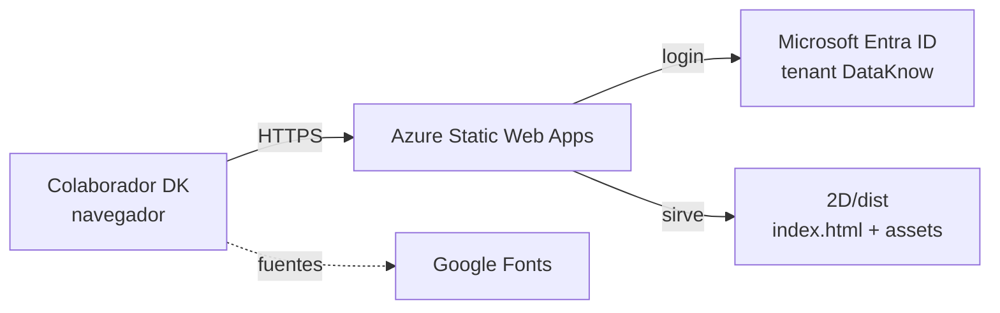
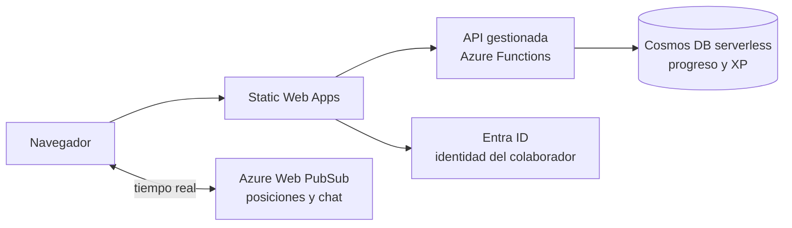

# Despliegue de The Office DK en Azure

Guía para publicar el juego en Azure.

---

## 1. Qué se despliega

The Office DK 2D es una **aplicación web estática** (React + Vite): el build genera unos 450 KB de HTML, JS y CSS en `2D/dist`. **No tiene backend**, base de datos ni variables de entorno.

Por eso el recurso recomendado es **Azure Static Web Apps (SWA)**:

- Sirve los archivos desde una red de distribución global, con HTTPS incluido.
- Trae inicio de sesión con **Microsoft Entra ID** (la cuenta corporativa de DataKnow) sin escribir código.
- Plan Free sin costo; plan Standard de bajo costo si se quiere restringir el acceso solo a colaboradores de DataKnow.



### ⚠️ Limitaciones actuales que hay que conocer antes de publicar

El juego **funciona completo** una vez desplegado, pero hoy guarda todo en el navegador de cada persona:

| Aspecto | Cómo funciona hoy | Consecuencia al publicarlo |
|---|---|---|
| Multijugador y chat | `BroadcastChannel` del navegador | Solo se ven las **pestañas del mismo navegador**. Dos colaboradores en equipos distintos **no se ven entre sí**; los compañeros del mapa son bots. |
| Progreso, XP, misión, mini-quiz | `localStorage` del navegador | Cada persona ve su propio avance, pero **RR.HH. no puede consultar quién completó el onboarding**. Si cambian de navegador o borran datos, empiezan de cero. |
| Inicio de sesión del juego | Formulario de nombre/correo, sin validación | Cualquiera puede escribir cualquier nombre. Con la protección de Entra ID (sección 4) al menos solo entran colaboradores DK. |

Para multijugador real y progreso centralizado ver [Fase 2](#10-fase-2-multijugador-real-y-progreso-centralizado).

---

## 2. Prerrequisitos

| Requisito | Detalle |
|---|---|
| Suscripción de Azure | Con permiso **Contributor** sobre el grupo de recursos donde se creará la app. |
| Permiso en Entra ID | Solo para la sección 4 (restringir a DataKnow): rol **Application Developer** o superior para registrar una aplicación. |
| Azure CLI | 2.60 o superior. Verificar con `az version`. |
| Node.js | 20 o superior (el proyecto se probó con Node 22 y npm 10). |
| Sesión iniciada | `az login` y, si hay varias suscripciones, `az account set --subscription "<nombre o id>"`. |

Los comandos de esta guía están en **PowerShell** y se ejecutan desde la raíz del proyecto (`The Office DK CL/`).

---

## 3. Despliegue con Azure Static Web Apps (recomendado)

### 3.1 Definir variables

```powershell
$RG   = "rg-theofficedk-prod"
$SWA  = "swa-theofficedk-prod"
$LOC  = "eastus2"   # Regiones válidas para SWA: westus2, centralus, eastus2, westeurope, eastasia
```

> La región solo define dónde se guardan los metadatos: el contenido se distribuye globalmente igual.

### 3.2 Crear el archivo de configuración de SWA

Crear **`2D/public/staticwebapp.config.json`**. Vite copia todo lo que está en `public/` a `dist/`, así que el archivo queda incluido en cada build.

**Variante A — acceso público (plan Free).** Cualquiera con el enlace puede entrar:

```json
{
  "navigationFallback": {
    "rewrite": "/index.html",
    "exclude": ["/assets/*"]
  },
  "routes": [
    {
      "route": "/assets/*",
      "headers": { "Cache-Control": "public, max-age=31536000, immutable" }
    }
  ],
  "globalHeaders": {
    "Content-Security-Policy": "default-src 'self'; script-src 'self'; style-src 'self' 'unsafe-inline' https://fonts.googleapis.com; font-src 'self' https://fonts.gstatic.com; img-src 'self' data:; connect-src 'self'; frame-ancestors 'none'; base-uri 'self'; form-action 'self'",
    "X-Content-Type-Options": "nosniff",
    "Referrer-Policy": "strict-origin-when-cross-origin",
    "Cache-Control": "no-cache"
  }
}
```

Para la **variante B (solo colaboradores DataKnow)**, usar el archivo de la [sección 4](#4-restringir-el-acceso-solo-a-colaboradores-de-dataknow).

Qué hace cada parte:

- `navigationFallback`: si alguien recarga en cualquier ruta, se sirve el juego en vez de un 404.
- `/assets/*` con caché de un año: Vite pone un hash en el nombre de esos archivos, así que cambian de nombre en cada versión y nunca quedan desactualizados.
- `Cache-Control: no-cache` global: el `index.html` siempre se revalida, así los usuarios reciben la versión nueva apenas se publica.
- `Content-Security-Policy`: solo permite código propio y las fuentes de Google. **Se validó** cargando el build de producción con estas cabeceras: el juego, el canvas, las fuentes y los modales funcionan sin errores.

### 3.3 Construir el juego

```powershell
npm ci
npm run build:2d
```

Resultado esperado: carpeta `2D/dist/` con `index.html`, `staticwebapp.config.json` y `assets/`.

```powershell
Test-Path 2D/dist/staticwebapp.config.json   # debe devolver True
```

### 3.4 (Opcional) Probar localmente con el emulador de SWA

Aplica las mismas reglas de rutas, cabeceras y login que tendrá Azure:

```powershell
npx @azure/static-web-apps-cli start 2D/dist
```

Abrir `http://localhost:4280`. Con la variante B el emulador muestra una pantalla de login simulada.

### 3.5 Crear los recursos en Azure

```powershell
az group create --name $RG --location $LOC

az staticwebapp create `
  --name $SWA `
  --resource-group $RG `
  --location $LOC `
  --sku Free
```

> Para la variante B usar `--sku Standard`, o subirlo después con `az staticwebapp update --name $SWA --resource-group $RG --sku Standard`.

### 3.6 Publicar

```powershell
$TOKEN = az staticwebapp secrets list --name $SWA --resource-group $RG --query "properties.apiKey" -o tsv

npx @azure/static-web-apps-cli deploy 2D/dist `
  --deployment-token $TOKEN `
  --env production
```

> 🔐 El token de despliegue es un secreto: no lo guardes en el repositorio ni en archivos del proyecto. Si se filtra, regenéralo con `az staticwebapp secrets reset-api-key --name $SWA --resource-group $RG`.

### 3.7 Obtener la URL

```powershell
$HOST_SWA = az staticwebapp show --name $SWA --resource-group $RG --query "defaultHostname" -o tsv
"https://$HOST_SWA"
```

Continuar con la [verificación](#7-verificación-después-de-publicar).

---

## 4. Restringir el acceso solo a colaboradores de DataKnow

El login de Entra ID que trae SWA en el plan Free acepta **cualquier cuenta Microsoft** (de cualquier empresa o personal). Para que **solo entren cuentas del tenant de DataKnow** se registra una aplicación propia en Entra ID, lo que requiere el **plan Standard**.

### 4.1 Subir el plan a Standard

```powershell
az staticwebapp update --name $SWA --resource-group $RG --sku Standard
```

### 4.2 Registrar la aplicación en Entra ID

```powershell
$TENANT_ID = az account show --query tenantId -o tsv
$HOST_SWA  = az staticwebapp show --name $SWA --resource-group $RG --query "defaultHostname" -o tsv

$APP_ID = az ad app create `
  --display-name "The Office DK" `
  --sign-in-audience AzureADMyOrg `
  --web-redirect-uris "https://$HOST_SWA/.auth/login/aad/callback" `
  --enable-id-token-issuance true `
  --query appId -o tsv

$APP_SECRET = az ad app credential reset `
  --id $APP_ID `
  --display-name "swa-theofficedk" `
  --years 1 `
  --append `
  --query password -o tsv
```

`AzureADMyOrg` es lo que limita el acceso a cuentas de tu propio tenant.

> Si después se agrega un dominio propio (sección 5), añade también `https://<dominio>/.auth/login/aad/callback` en **Entra ID → Registros de aplicaciones → The Office DK → Autenticación**.

### 4.3 Guardar las credenciales en la configuración de la app

```powershell
az staticwebapp appsettings set `
  --name $SWA `
  --resource-group $RG `
  --setting-names "AZURE_CLIENT_ID=$APP_ID" "AZURE_CLIENT_SECRET=$APP_SECRET"
```

> El secreto vence en un año (`--years 1`). Agenda su renovación: repetir el `credential reset` y el `appsettings set`.

### 4.4 Usar esta configuración en `2D/public/staticwebapp.config.json`

Reemplazar `<TENANT_ID>` por el valor de `$TENANT_ID`:

```json
{
  "auth": {
    "identityProviders": {
      "azureActiveDirectory": {
        "registration": {
          "openIdIssuer": "https://login.microsoftonline.com/<TENANT_ID>/v2.0",
          "clientIdSettingName": "AZURE_CLIENT_ID",
          "clientSecretSettingName": "AZURE_CLIENT_SECRET"
        }
      }
    }
  },
  "navigationFallback": {
    "rewrite": "/index.html",
    "exclude": ["/assets/*"]
  },
  "routes": [
    { "route": "/.auth/login/github", "statusCode": 404 },
    { "route": "/.auth/login/twitter", "statusCode": 404 },
    {
      "route": "/assets/*",
      "allowedRoles": ["authenticated"],
      "headers": { "Cache-Control": "public, max-age=31536000, immutable" }
    },
    { "route": "/*", "allowedRoles": ["authenticated"] }
  ],
  "responseOverrides": {
    "401": {
      "statusCode": 302,
      "redirect": "/.auth/login/aad?post_login_redirect_uri=.referrer"
    }
  },
  "globalHeaders": {
    "Content-Security-Policy": "default-src 'self'; script-src 'self'; style-src 'self' 'unsafe-inline' https://fonts.googleapis.com; font-src 'self' https://fonts.gstatic.com; img-src 'self' data:; connect-src 'self'; frame-ancestors 'none'; base-uri 'self'; form-action 'self'",
    "X-Content-Type-Options": "nosniff",
    "Referrer-Policy": "strict-origin-when-cross-origin",
    "Cache-Control": "no-cache"
  }
}
```

Qué agrega respecto a la variante A:

- `auth`: usa la aplicación registrada en 4.2, que solo acepta cuentas de DataKnow.
- `allowedRoles: ["authenticated"]`: nadie ve el juego sin iniciar sesión.
- `responseOverrides.401`: quien no ha iniciado sesión va directo al login de Microsoft y vuelve al juego al terminar.
- Rutas de GitHub y Twitter en 404: deshabilita esos proveedores de login que SWA trae por defecto.

### 4.5 Volver a construir y publicar

```powershell
npm run build:2d
npx @azure/static-web-apps-cli deploy 2D/dist --deployment-token $TOKEN --env production
```

---

## 5. Dominio propio (opcional)

Ejemplo con `oficina.dataknow.co`:

1. En el DNS de `dataknow.co` crear un registro **CNAME**: `oficina` → valor de `$HOST_SWA`.
2. Asociarlo a la app:

   ```powershell
   az staticwebapp hostname set --name $SWA --resource-group $RG --hostname oficina.dataknow.co
   ```

3. Azure emite y renueva el certificado HTTPS automáticamente (puede tardar unos minutos).
4. Si usas la sección 4, agrega la URL de callback del dominio nuevo en el registro de la aplicación.

---

## 6. Despliegue continuo (CI/CD)

> El proyecto todavía **no está en un repositorio git**. Para publicar automáticamente en cada cambio, primero súbelo a GitHub o Azure Repos (ya existe un `.gitignore` en la raíz).

Guarda el token de despliegue (`$TOKEN`) como secreto del repositorio con el nombre `AZURE_STATIC_WEB_APPS_API_TOKEN`.

### GitHub Actions — `.github/workflows/deploy-azure.yml`

```yaml
name: Desplegar The Office DK

on:
  push:
    branches: [main]
  workflow_dispatch:

jobs:
  deploy:
    runs-on: ubuntu-latest
    steps:
      - uses: actions/checkout@v4

      - uses: actions/setup-node@v4
        with:
          node-version: 22
          cache: npm

      - run: npm ci
      - run: npm run build:2d

      - uses: Azure/static-web-apps-deploy@v1
        with:
          azure_static_web_apps_api_token: ${{ secrets.AZURE_STATIC_WEB_APPS_API_TOKEN }}
          action: upload
          app_location: 2D/dist
          skip_app_build: true
          api_location: ""
```

### Azure DevOps — `azure-pipelines.yml`

```yaml
trigger:
  branches:
    include: [main]

pool:
  vmImage: ubuntu-latest

steps:
  - task: NodeTool@0
    inputs:
      versionSpec: '22.x'

  - script: |
      npm ci
      npm run build:2d
    displayName: Construir juego 2D

  - task: AzureStaticWebApp@0
    inputs:
      app_location: '2D/dist'
      skip_app_build: true
      azure_static_web_apps_api_token: $(AZURE_STATIC_WEB_APPS_API_TOKEN)
```

Se construye en el pipeline y se publica la carpeta ya armada (`skip_app_build: true`) porque el proyecto usa *workspaces* de npm con un único `package-lock.json` en la raíz.

### Ambiente de pruebas antes de producción

Para revisar una versión sin afectar a los usuarios:

```powershell
npx @azure/static-web-apps-cli deploy 2D/dist --deployment-token $TOKEN --env staging
```

Genera una URL separada para el ambiente `staging`. Cuando esté aprobada, se publica con `--env production`.

---

## 7. Verificación después de publicar

- [ ] La URL abre con HTTPS y muestra la pantalla **"The Office DK"**.
- [ ] (Variante B) Pide iniciar sesión con la cuenta de DataKnow y rechaza una cuenta personal o de otra empresa.
- [ ] Se puede crear el avatar y entrar a la oficina.
- [ ] El personaje se mueve con WASD / flechas y el mapa (tecla **M**) se ve completo.
- [ ] Abren los modales: misión, mini-quiz, simulador, Red DK.
- [ ] Recargar el navegador (F5) mantiene la sesión y el progreso.
- [ ] La consola del navegador (F12) no muestra errores de `Content-Security-Policy`.
- [ ] Las fuentes se ven correctamente (Outfit). Si se ven genéricas, la red corporativa podría estar bloqueando `fonts.googleapis.com`.

---

## 8. Costos estimados

| Plan | Cuándo usarlo | Costo aproximado |
|---|---|---|
| **Free** | Piloto o acceso público con datos ficticios | USD 0 (incluye 100 GB de transferencia al mes) |
| **Standard** | Acceso restringido solo a DataKnow (sección 4) y dominio propio con SLA | ~USD 9 por app al mes, más transferencia por encima de lo incluido |

Con 200 colaboradores y un build de ~450 KB, la transferencia mensual queda muy por debajo de lo incluido. Verifica los precios vigentes en la [página de precios de Static Web Apps](https://azure.microsoft.com/pricing/details/app-service/static/).

---

## 9. Alternativa: Azure Storage (sitio web estático)

Más simple, pero **sin login ni cabeceras de seguridad propias**: cualquiera con la URL entra. Para agregar esas capacidades habría que poner Azure Front Door delante, lo que cuesta más que SWA Standard. Útil solo para una demo rápida.

```powershell
$ST = "sttheofficedk$((Get-Random -Maximum 9999))"   # nombre único global, solo minúsculas y números

az storage account create --name $ST --resource-group $RG --location $LOC `
  --sku Standard_LRS --kind StorageV2 --allow-blob-public-access false

az storage blob service-properties update --account-name $ST --auth-mode login `
  --static-website --index-document index.html --404-document index.html

az storage blob upload-batch --account-name $ST --auth-mode login `
  --source 2D/dist --destination '$web' --overwrite

az storage account show --name $ST --resource-group $RG --query "primaryEndpoints.web" -o tsv
```

> `--auth-mode login` requiere el rol **Storage Blob Data Contributor** sobre la cuenta. El archivo `staticwebapp.config.json` no tiene efecto aquí.

---

## 10. Fase 2: multijugador real y progreso centralizado

Para que los colaboradores se vean entre sí y RR.HH. pueda consultar el avance del onboarding hace falta un backend. Encaja con lo ya desplegado:



| Necesidad | Servicio | Cambio en el código |
|---|---|---|
| Identidad real del colaborador | Entra ID ya configurado (sección 4); el juego lee `/.auth/me` | `AuthModal.jsx`: tomar nombre y correo de la sesión en vez del formulario |
| Progreso, XP y ranking compartidos | Azure Functions como API de SWA (carpeta `api/`) + Cosmos DB serverless | `App.jsx`: reemplazar `localStorage` por llamadas a la API en `updateProgress` y en el login |
| Ver a los demás jugadores y chatear | Azure Web PubSub | `App.jsx`: reemplazar el `BroadcastChannel` por la conexión de Web PubSub (mismos mensajes `USER_MOVE` y `CHAT_MESSAGE`) |
| Reporte para RR.HH. | Consulta sobre Cosmos DB o exportación a Power BI | Nuevo; no afecta al juego |

> Web PubSub: el plan Free admite 20 conexiones simultáneas; para 200 colaboradores se necesita el plan Standard (1 unidad = 1.000 conexiones).

---

## 11. Problemas frecuentes

| Síntoma | Causa probable | Solución |
|---|---|---|
| 404 al recargar la página | Falta `staticwebapp.config.json` en el build | Verificar que exista en `2D/public/` y en `2D/dist/` tras el build. |
| Bucle de redirecciones al login | Falta la URL de callback o las credenciales | Revisar la redirect URI del registro de la app y `az staticwebapp appsettings list --name $SWA --resource-group $RG`. |
| "AADSTS50020" o usuario rechazado | La cuenta no pertenece al tenant de DataKnow | Es el comportamiento esperado de la variante B. |
| Tras publicar, los usuarios ven la versión vieja | Caché del navegador | Con la configuración de esta guía basta recargar; confirmar que `index.html` responde `Cache-Control: no-cache`. |
| Fuentes genéricas | Proxy corporativo bloquea Google Fonts | Permitir `fonts.googleapis.com` y `fonts.gstatic.com`, o alojar las fuentes en `2D/public/fonts` y ajustar `index.html` y la CSP. |
| `swa deploy` falla con token inválido | Token regenerado o de otra app | Volver a obtenerlo con `az staticwebapp secrets list` (sección 3.6). |
| Dos colaboradores no se ven en el mapa | Limitación actual (sección 1) | Requiere la Fase 2. |

---

## Referencias

- [Documentación de Azure Static Web Apps](https://learn.microsoft.com/azure/static-web-apps/)
- [Archivo de configuración `staticwebapp.config.json`](https://learn.microsoft.com/azure/static-web-apps/configuration)
- [Autenticación personalizada con Entra ID](https://learn.microsoft.com/azure/static-web-apps/authentication-custom)
